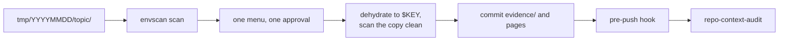

# Context Lab

The lab where agent context is designed, and the package that ships it to every
host in the fleet.

**No clone required.** `marketplace add` fetches the whole repository for you, so
all three commands are typed as-is:

```sh
claude plugin marketplace add luutuankiet/context-lab
claude plugin install context-lab@context-lab
~/.claude/plugins/marketplaces/context-lab/install.sh
```

**The third command is the one nothing will remind you about.** The first two give
you the skills; the plugin model has no post-install step of any kind, so the
config tier — statusline, hooks, settings, the user-memory import — is applied only
by running the installer out of the fetched clone. There is no credential to put on
a machine.

**The installer is a one-time bootstrap, not part of the update loop.** To keep a
host current you run one command, and it refreshes skills *and* user memory
together — the memory import points into the directory this re-fetches:

```sh
claude plugin marketplace update context-lab
```

Re-run the installer only when the *installer's own* scope changes — a new owned
`settings.json` key, a new hook, a new shell export. Editing memory or a skill
never needs it:

```sh
~/.claude/plugins/marketplaces/context-lab/install.sh
~/.claude/plugins/marketplaces/context-lab/install.sh --check   # verify, mutate nothing
```

⚠️ `marketplace update` **deletes the directory and re-clones** rather than pulling.
The path is stable, so the import survives — but an update that dies partway (no
network, no git auth) leaves a host silently running with no memory at all, because
an unresolved `@`-import produces no error. `--check` warns when the target is
missing; it is the only thing that will tell you.

Developing on it instead? Clone it anywhere you like and run that clone's
`install.sh`. **Nothing follows the clone.** Hooks, skills and the statusline
contributor reach a host as plugin content addressed by `${CLAUDE_PLUGIN_ROOT}`,
so what runs is always the commit the marketplace published — never your working
copy. Editing a file here changes nothing on any host until you push and re-run
`marketplace update` ([ADR 0014](docs/adr/0014-executables-ship-as-plugin-content.md)).

## Keeping sensitive values out of committed docs

**The problem.** An agent does its working in a gitignored `tmp/YYYYMMDD/<topic>/`
folder: scripts, notes, run logs. The useful part has to end up in committed docs
or evidence, and that copy is exactly where a production host, a service account
or a client name slips into git history.

**The answer is a program plus a workflow.** The program is
envscan `https://github.com/luutuankiet/envscan`: it reads the repo's gitignored
`.env` (one identifying value per key) and finds those values in text, or swaps
them for a bare `$KEY`. The workflow is the opt-in `promote-tmp` skill, which you
run at wrap-up:

```text
/context-lab:promote-tmp tmp/YYYYMMDD/<topic>
```



1. Every file gets one of five handlings: `snapshot` (a script, or tool output a
   page cites, copied dehydrated), `write-up` (prose rewritten as a fresh page or
   issue, never copied), `cache` (a pointer with a rebuild command), `discard`, or
   `refuse` (credentials, regulated data, another client's material).
2. Every copy goes through `envscan dehydrate`, so each known value becomes a bare
   `$KEY`, and the copy must scan clean before it is committed.
3. You approve one menu listing every file, its handling and every value found;
   nothing is written before that.
4. The git `pre-push` hook (`envscan gate`) is the last net: it refuses a push that
   still carries a known value.
5. The skill ends by handing off to `repo-context-audit`, so what the session
   learned reaches `AGENTS.md` and `docs/`.

**A worked example, on fake values.** A `.env` holding
`DB_HOST_A=acme-prod-db.example.internal` and two more keys, and a topic folder
with a run log and a note. The scan finds every value and names only the keys:

```text
$ envscan scan --known-only --no-ignore tmp/20261101/db-latency
tier: plain
rules loaded: 3   files scanned: 2   skipped: 0 large, 0 binary, 0 non-utf8, 0 secret-named, 0 long lines

LEAKS  4 hits across 3 keys (write as $KEY)
  DB_HOST_A            strict    2  loose    0  tmp/20261101/db-latency/notes.md:4  tmp/20261101/db-latency/run.log:1
  ACCOUNT_A            strict    1  loose    0  tmp/20261101/db-latency/run.log:1
  CLIENT_A             strict    1  loose    0  tmp/20261101/db-latency/notes.md:3
```

The log line `connect host=acme-prod-db.example.internal user=etl-runner@...`
dehydrates to a copy that is safe to commit:

```text
$ envscan dehydrate tmp/20261101/db-latency/run.log
2026-11-01T09:12:03Z connect host=$DB_HOST_A user=$ACCOUNT_A
2026-11-01T09:12:04Z query p50=41ms p95=212ms rows=18000
2026-11-01T09:12:04Z done
```

The note is prose, so it is a `write-up`, not a copy: the scan proves a value is
there, and the rewrite removes it. `envscan hydrate` turns a `$KEY` back into the
real value on your own machine when you need it.

**Opt-in.** It runs only when you invoke it, in a repo with a `.env`. A repo set up
by `repo-context-audit` alone, and anyone working in it, sees no change. Why it is
shaped this way: [ADR 0015](docs/adr/0015-tmp-promotion-copies-what-runs-and-rewrites-what-is-read.md),
[ADR 0016](docs/adr/0016-no-outbound-gate-on-agent-tool-calls.md),
[ADR 0017](docs/adr/0017-promotion-keeps-cited-output-and-is-opt-in.md).

## What is in here

| tree | role | how it reaches a host |
|---|---|---|
| `claude/` | the **payload** — settings keys, the memory import, the hook script, the statusline dispatcher | mostly as plugin content; only the dispatcher is written to `~/.claude/` |
| `skills/` | the **distributed** skills collection — only `stable/` ships | as plugin content, enforced by `"skills": ["./skills/stable"]` |
| `statusline.d/` | this repo's statusline contributors — one executable per segment | discovered every render; no registration |
| `hooks/hooks.json` | the plugin's hook bindings | discovered by filename; no manifest key names it |
| `install.sh` | the distributor — registers plugins, merges owned settings keys, appends the memory import and the shell block | you, once per host |
| `.claude-plugin/` | the marketplace and plugin manifests | Claude Code, on install |
| `scripts/`, `tests/` | repo tooling and the dispatcher's own suite | nobody — never leaves this repo |
| `docs/` | the lab's own writing | humans, and agents on demand |
| `AGENTS.md`, `CLAUDE.md`, `.claude/` | **this repo's own** harness config | agents working *on* Context Lab |

## The marketplace publishes more than this repo

`marketplace add` gives you a catalogue of seven plugins, not one. `context-lab`
is this repository; the other six are separate public repositories the manifest
points at, so each is installed and updated on its own:

```sh
claude plugin install <name>@context-lab
```

| plugin | source |
|---|---|
| `context-lab` | this repository |
| `write-pr` | `luutuankiet/write-pr` |
| `learn-with-feedback-loop` | `luutuankiet/learn-with-feedback-loop` |
| `dbtcx` | `luutuankiet/dbtcx` |
| `looker-mcp-shim` | `luutuankiet/looker-mcp-shim` |
| `slides-mcp` | `luutuankiet/slides-mcp` |
| `skills-utils` | `luutuankiet/skills-utils` |

Installing one does not install the rest. `install.sh` registers the whole set
from a list it holds itself, which is why re-running it is how a host picks up a
newly published plugin — and why adding one to the marketplace manifest is only
half the change.

## The one structural requirement

> Two trees must stay unambiguous: what Context Lab uses to **maintain itself**
> versus what it **distributes**. Otherwise the lab's own scaffolding leaks into
> every repo it touches.

The cut is the leading dot — `.claude/` configures agents working on this repo and
ships nowhere; `claude/` is the payload. ⚠️ One character. Read the path twice
before editing either. Why it was cut there:
[ADR 0001](docs/adr/0001-two-trees-cut-on-the-leading-dot.md).

## The naming rule

*Context Lab* names the lab. **What it emits into any other repo carries no brand at
all** — a canonical shape any agent reads as "this repo is laid out well," not a
methodology to learn first. If you find the string "Context Lab" inside a file
destined for another repo, that file is wrong.

## Documentation

Start at **[AGENTS.md](AGENTS.md)** — it is what an agent loads, and it is short
enough to read in a minute.

Everything else is indexed in **[docs/README.md](docs/README.md)**: how the
installer works, the traps that have already cost somebody an afternoon, the
reference detail, and the decisions behind the shape.
